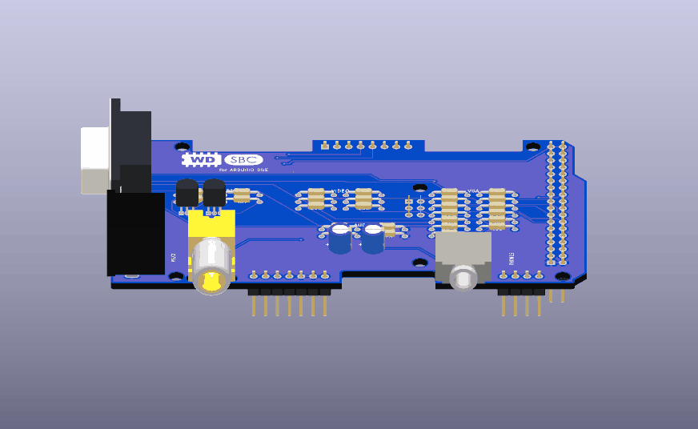
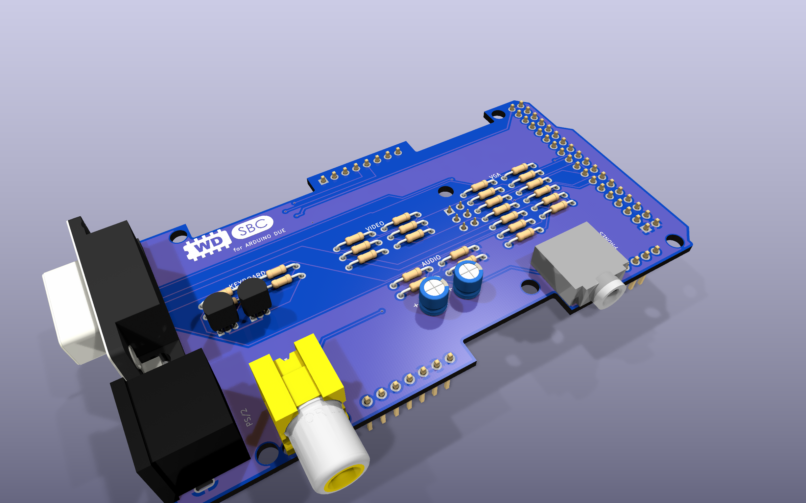
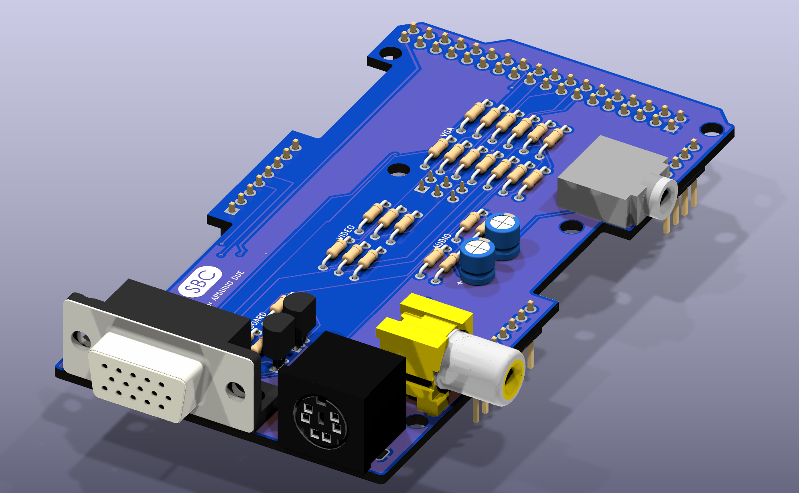
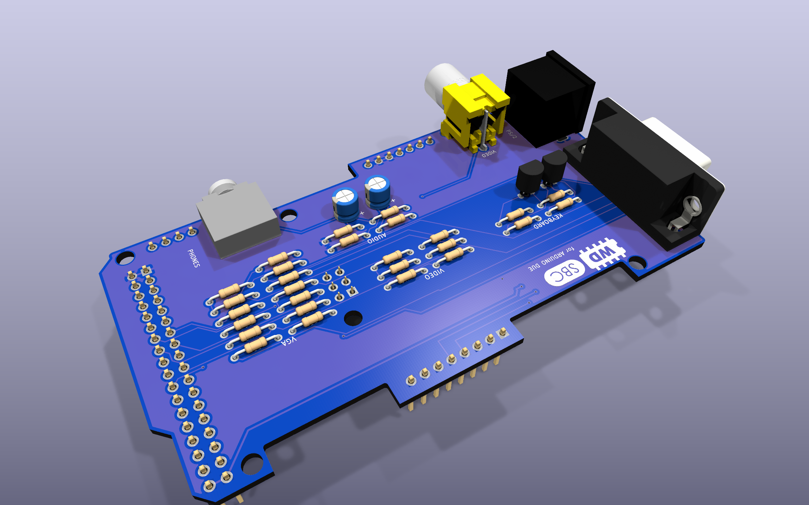
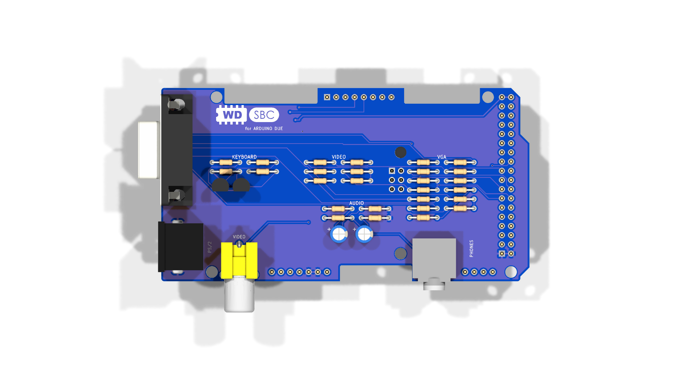
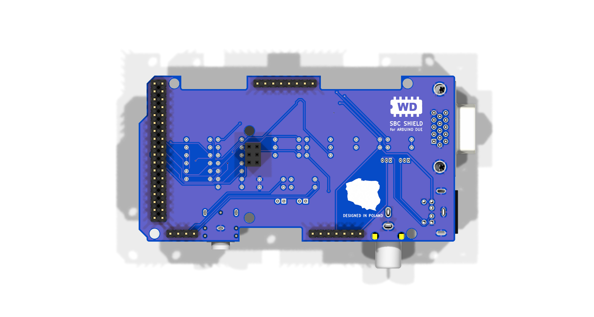
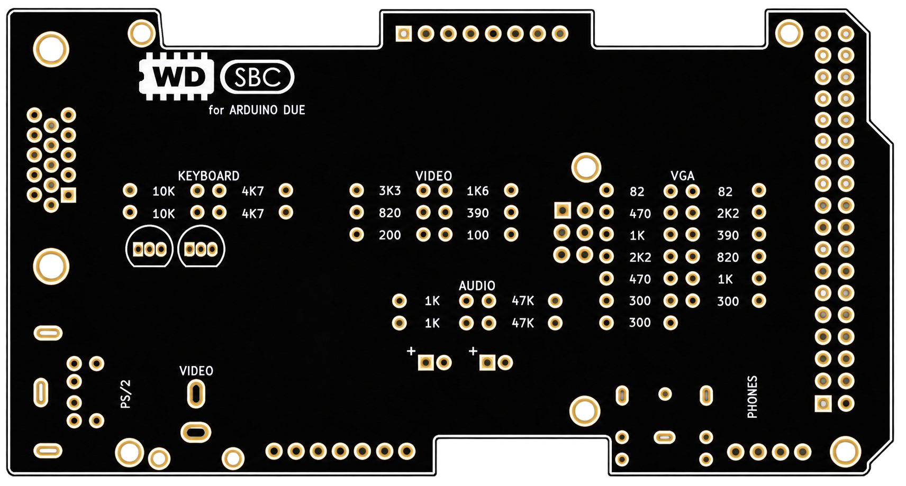

# SBC Shield for Arduino Due

**Turn an Arduino Due into a tiny computer.** Use VGA or cinch to connecto to monitor, a PS/2 keyboard and headphones.

<p align="center"></p>

## Perks:
- **Fully passive:** no extra microcontroller, just resistors, two transistors and connectors.
- **Through-hole parts only:** easy to solder ans easily accesible parts.
- **No jumpers or switches:** plug it onto the Due and go.
- **Unused Due headers stay reachable:** three cut-outs in the board edge leave D8–D13, SDA1/SCL1, AREF, the serial ports TX1–3/RX1–3 with SDA/SCL (D14–D21) and A0–A7 free for your use.

> **Status:** rev 1 – First version. There might be some bugs, if u will see some report them.
>
> ⚠️ **Arduino Due only.** The resistor values and pins match the Due's 3.3 V I/O and the DueVGA library. On other boards the outputs won't work.

---

## Features

| Port | Mode | Resolution | Colours | Library |
|---|---|---|---|---|
| **VGA** | colour | 320×240 | 256 (RRRGGGBB) | [DueVGA](https://github.com/stimmer/DueVGA) |
| **VGA** | monochrome | up to 800×600 | black & white | [DueVGA](https://github.com/stimmer/DueVGA)  |
| **VIDEO** (RCA) | PAL composite | 320×240 | 256 | [DueVGA](https://github.com/stimmer/DueVGA)  |
| **VIDEO** (RCA) | NTSC composite | 320×200 | 256 | [DueVGA](https://github.com/stimmer/DueVGA)  |
| **PS/2** | keyboard | – | – | [PS2Keyboard](https://github.com/PaulStoffregen/PS2Keyboard) |
| **PHONES** (3.5 mm) | stereo line out | 12-bit DAC | – | `analogWrite(DAC0/DAC1, …)` |
| **Free Due pins** | edge cut-outs | – | – | D8–D21, SDA/SCL, A0–A7 |

**REMEMBER**: U can't use VGA and RCA at the same time since they are sharing same pins, choose between them in software.

## Board



| Ports: VGA, PS/2, VIDEO, PHONES | Back side |
|---|---|
|  |  |

| Top | Bottom |
|---|---|
|  |  |

Schematic: [docs/schematic.pdf](docs/schematic.pdf)

## Pins used

| Due pin | Function |
|---|---|
| 34–41 | VGA colour (R 39–41, G 36–38, B 34–35) |
| 36–41 | composite video DAC (same pins, separate resistor ladder) |
| 42 / 43 | VGA VSYNC / HSYNC |
| SPI header MOSI (via the 2x3 socket J15 on the bottom) | monochrome VGA |
| 3 / 4 | PS/2 CLK / DATA |
| DAC0 / DAC1 | audio left / right |
| 5V, GND, IOREF | power, keyboard level reference |

## Parts

| Qty | Part | References | Used for |
|---:|---|---|---|
| 2 | 82 Ω | R9, R10 | VGA HSYNC / VSYNC |
| 1 | 100 Ω | R19 | composite video |
| 1 | 200 Ω | R18 | composite video |
| 3 | 300 Ω | R11, R12, R13 | VGA mono |
| 2 | 390 Ω | R7, R17 | VGA blue, composite video |
| 2 | 470 Ω | R1, R4 | VGA red, green |
| 2 | 820 Ω | R8, R16 | VGA blue, composite video |
| 4 | 1 kΩ | R2, R5, R21, R24 | VGA red, green; audio |
| 1 | 1.6 kΩ | R15 | composite video |
| 2 | 2.2 kΩ | R3, R6 | VGA red, green |
| 1 | 3.3 kΩ | R14 | composite video |
| 2 | 4.7 kΩ | R33, R34 | PS/2 pull-ups (5 V side) |
| 2 | 10 kΩ | R31, R32 | PS/2 pull-ups (3.3 V side) |
| 2 | 47 kΩ | R27, R28 | audio load |
| 2 | 10 µF electrolytic, 5 mm | C3, C4 | audio DC blocking |
| 2 | 2N7000 (TO-92) | Q1, Q2 | PS/2 level shifters |
| 1 | DE-15 HD VGA socket, right-angle | J8 | VGA |
| 1 | RCA jack, CUI RCJ-041 (yellow) | J9 | composite video |
| 1 | 3.5 mm stereo jack, CUI SJ1-3523N | J10 | audio |
| 1 | mini-DIN 6 socket, CUI MD-60SM | J12 | PS/2 keyboard |
| 1 | 2x18 male header, 2.54 mm | J7 | Due D22–D53 |
| 1 | 1x8 male header | J4 | Due D0–D7 |
| 1 | 1x7 male header | J1 | Due power |
| 1 | 1x4 male header | J5 | Due DAC0, DAC1, CANRX, CANTX |
| 1 | 2x3 female header, 2.54 mm (bottom side) | J15 | Due SPI header (mono VGA) |


## Quick start

```cpp
#include <VGA.h>            // DueVGA
#include <PS2Keyboard.h>

PS2Keyboard kbd;

void setup() {
  VGA.begin(320, 240, VGA_COLOUR);   // or VGA.begin(800, 600) for mono, or PAL / NTSC
  kbd.begin(4, 3);                   // DATA = 4, CLK/IRQ = 3
}

void loop() {
  if (kbd.available()) VGA.print((char)kbd.read());
}
```

Sound:

```cpp
analogWriteResolution(12);
analogWrite(DAC0, 2048);             // left channel, 0..4095
analogWrite(DAC1, 2048);             // right channel
```

## How to build and use it

1. Order the PCB: download `SBC_Carrier_JLCPCB.zip` and upload to JLCPCB.
2. Get the parts from the list.
3. Solder components with help of pcb image below.
4. Plug the shield into DUE.
5. Trim the leads under the VGA and PS/2 connectors since they might be blocking.


### Notes
- **Headphones:** the DAC output is line level. High-impedance headphones and amplified speakers are fine; low-impedance earbuds will be quiet.
- **Hot-plugging:** don't hot-plug the PS/2 keyboard.


## Roadmap

- [ ] Build and test rev 1 (VGA colour, VGA mono, composite, keyboard, audio)
- [ ] Demo firmware: text terminal on VGA with keyboard input
- [ ] Diy OS
- [ ] Photos of the assembled board and screenshots from a real monitor

## Credits

- [DueVGA](https://github.com/stimmer/DueVGA) by stimmer – the VGA / composite resistor networks follow its wiring.
- [PS2Keyboard](https://github.com/PaulStoffregen/PS2Keyboard) by Paul Stoffregen.

## License

MIT 

